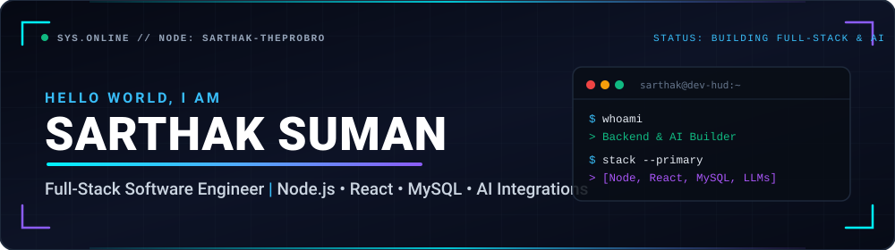

<div align="center">

<!-- ======================== FUTURISTIC HERO BANNER ======================== -->


<br />

<!-- ======================== ANIMATED TYPING SVG ======================== -->
<a href="https://github.com/Sarthak-theprobro">
  
</a>

<br />

<!-- ======================== SOCIAL & CONTACT HUD BADGES ======================== -->
<p align="center">
  <a href="https://linkedin.com/in/sarthak-suman-76226a17b" target="_blank">
    
  </a>
  <a href="mailto:sarthaksmn720@gmail.com">
    
  </a>
  <a href="https://github.com/Sarthak-theprobro">
    
  </a>
  
</p>

</div>

---

### ⚡ `// SYSTEM.OVERVIEW` — About Me

```yaml
developer:
  name: "Sarthak Suman"
  handle: "@Sarthak-theprobro"
  education: "B.E. in Electrical & Electronics Engineering — BIT Patna"
  role: "Software Engineer (Full-Stack & AI Applications)"
  location: "Surat, India 🇮🇳"

what_i_do:
  - "🛠️ Build end-to-end web & mobile apps using Node.js, Express, React, and React Native"
  - "🤖 Connect LLM APIs into practical tools (AI worksheet generators, smart tutors, workflow helpers)"
  - "💳 Implement real-world backend features: Razorpay webhooks, JWT auth, RBAC, and MySQL schemas"
  - "🧪 Love experimenting with modern UI tools, developer utilities, and automation scripts"

current_mission: "Sharpening full-stack system design & shipping practical AI-powered apps."
```

---

### 🧰 `// TECH.ARSENAL` — Languages, Frameworks & Tools

<div align="center">

#### **Frontend & Mobile**
<p>
  
  
  
  
  
  
  
</p>

#### **Backend, Databases & Integrations**
<p>
  
  
  
  
  
  
  
</p>

#### **AI & Developer Workflow**
<p>
  
  
  
  
  
  
</p>

</div>

---

### 🚀 `// FEATURED.BUILDS` — What I've Been Working On

<table width="100%">
  <tr>
    <td width="50%" valign="top">
      <h3 align="center">📱 Student Lead CRM & Analytics</h3>
      <p align="center">
        <code>React Native</code> • <code>Expo</code> • <code>AsyncStorage</code> • <code>Context API</code>
      </p>
      <ul>
        <li>Built a mobile CRM app featuring a dynamic <b>0–100 lead scoring algorithm</b> with instant <i>Hot / Warm / Cold</i> visual badges.</li>
        <li>Designed reusable UI components and offline-first local persistence so leads stay synced without internet drops.</li>
      </ul>
      <p align="center">
        <a href="https://github.com/Sarthak-theprobro/student-lead-crm-react-native">
          
        </a>
      </p>
    </td>
    <td width="50%" valign="top">
      <h3 align="center">🏢 Multi-Tenant Property & Event Platform</h3>
      <p align="center">
        <code>MongoDB</code> • <code>Express</code> • <code>React</code> • <code>Node.js</code> • <code>JWT</code>
      </p>
      <ul>
        <li>Full-stack MERN dashboard with <b>role-based access control (RBAC)</b>, JWT route protection, and 15+ REST API endpoints.</li>
        <li>Includes multi-filter property search, booking status tracking, and a responsive analytics dashboard.</li>
      </ul>
      <p align="center">
        <a href="https://github.com/Sarthak-theprobro/mern-event-app-property-dashboard">
          
        </a>
      </p>
    </td>
  </tr>
  <tr>
    <td width="50%" valign="top">
      <h3 align="center">🤖 AI Curriculum & Worksheet Pipelines</h3>
      <p align="center">
        <code>Node.js</code> • <code>MySQL</code> • <code>LLM APIs</code> • <code>Razorpay</code>
      </p>
      <ul>
        <li>Engineered backend routing for 4 AI education tools (<i>Lesson Planner, Quiz Generator, Homework Helper, AI Tutor</i>).</li>
        <li>Built webhook signature verification, subscription state checks, and resilient email dispatchers.</li>
      </ul>
    </td>
    <td width="50%" valign="top">
      <h3 align="center">📄 ATS Resume Builder & PDF Workstation</h3>
      <p align="center">
        <code>React</code> • <code>TypeScript</code> • <code>Tailwind CSS</code> • <code>Vite</code>
      </p>
      <ul>
        <li>Interactive developer resume studio with live multi-template preview, real-time ATS keyword scoring, and clean PDF export.</li>
        <li>Built to explore fast client-side state management and modern TypeScript component patterns.</li>
      </ul>
    </td>
  </tr>
</table>

---

### 📊 `// TELEMETRY.METRICS` — GitHub Activity & Stats

<div align="center">
  
  
</div>

<div align="center">
  
</div>

<div align="center">
  
</div>

---

<div align="center">
  <p>
    <i>"First make it work, then make it clean, and always keep learning how it works under the hood."</i>
  </p>
  
</div>
